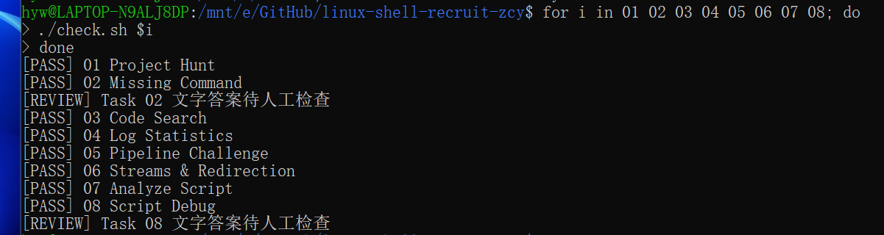

# Linux Shell 学习笔记（Task 01 ~ 08）

## 说明
从零基础开始，一边做作业一边学。借助 AI 辅助理解原理、排查报错，但每一条命令都亲手敲过、跑通过。

---

## Task 01 — Project Hunt

**笔记**
- `grep -rn "关键字" 目录`：递归搜索文件内容，`-n` 显示行号。
- `ls -la`：显示所有文件，包括以 `.` 开头的隐藏文件。
- Linux 里隐藏文件就是以 `.` 开头的文件，普通的 `ls` 看不到。
- 相对路径中，`..` 代表退到上一级目录。从 `workspace/src/utils/` 走到 `workspace/.project/metadata`，要退两层，写成 `../../.project/metadata`。

---

## Task 02 — Missing Command

**笔记**
- `chmod +x 文件`：给文件加“可执行”权限。Linux 判断一个文件能不能运行，看的是权限位，不是后缀名。
- `export PATH="$PATH:$(pwd)/tools"`：把当前目录下的 `tools` 临时加进 `PATH`。
- `PATH` 是系统查找命令的“白名单”，只有在这个白名单里的目录才会被搜索。直接敲命令名找不到，就是因为所在目录不在 `PATH` 里。
- 引用变量要加双引号，否则值里的空格会把变量“切碎”。
- 执行 `export` 时，如果当前目录不对，`$(pwd)` 会取到错误的路径，导致 `PATH` 加错地方。

---

## Task 03 — Code Search

**笔记**
- `grep -l`（小写 L）：只输出文件名，不输出匹配的内容。
- `grep -L`（大写 L）：反过来，输出“不包含”关键词的文件名。大小写不能搞混。
- `grep -E`：扩展正则，可以用 `|` 表示“或者”。
- `grep -I`：忽略二进制文件，只搜普通文本。
- 管道 `|`：把前一个命令的输出，直接传给后一个命令。
- `sort | uniq`：先排序，再去重。

---

## Task 04 — Log Statistics

**笔记**
- `cut -d ' ' -f 4`：以空格为分隔符，取第 4 列。
- `wc -l`：统计行数。
- `sort | uniq -c`：排序并统计每个值出现的次数。
- `sort -nr`：按数字从大到小排序。
- `head -n 1`：取第一行，也就是排名第一的那条。
- `grep -o`：只输出匹配到的那一小段，不输出整行。
- 提取字段时，用 `cut` 比用正则表达式更稳，不容易报错。
- `uniq -c` 输出的数字和内容之间可能有大量空格，直接 `cut` 会切不到，需要用 `tr -s ' '` 先把空格压缩掉。

---

## Task 05 — Pipeline Challenge

**笔记**
- `cut -d ' ' -f 1`：把每行的第一列（IP）切出来。
- `tr -s ' '`：把连续多个空格压缩成一个。
- 一条完整的流水线：
  `cut → sort → uniq -c → sort -nr → head -n 1 → tr -s ' ' → cut`
- 管道是 Linux 的核心思路：一个命令只做一件事，串起来就能完成复杂任务。
- 题目要求不能用中间文件，就必须把所有步骤用管道串成一条命令。

---

## Task 06 — Streams & Redirection

**笔记**
- `>` ：把标准输出（stdout）重定向到文件。
- `2>` ：把标准错误（stderr）重定向到文件。
- stdout 和 stderr 是两个独立的通道，可以分别重定向到不同的文件。
- `|` ：管道，把输出传给下一个命令。
- `tee` ：把数据一分为二，一份写入文件，一份显示在屏幕上。
- `/dev/null` ：Linux 的“黑洞”，扔进去的数据直接丢弃，常用来忽略不需要的输出。

---

## Task 07 — Analyze Script

**笔记**
- `$1`：第一个参数；`$#`：参数个数；`$@`：所有参数。
- `if [[ 条件 ]]; then ... fi`：Shell 的条件判断结构。
- `-lt`：小于；`! -f`：判断文件不存在；`-f`：判断是否是存在的普通文件。
- `exit 0`：成功退出；`exit 1`：出错退出。
- `$(...)`：把命令的输出结果赋值给变量。
- 写脚本时，用 `cat > 文件 << 'EOF' ... EOF` 从终端整块写入，比在编辑器里手写更稳，不容易漏引号。
- 脚本里命令前面必须是 Tab 缩进，不能用空格。

---

## Task 08 — Script Debug

**笔记**
- 不带引号的变量 `$var`，Shell 会按空格把它“切碎”，带空格的文件名会被拆成两个参数。
- 加引号的 `"$var"`，Shell 会把它当成一个整体，不会被空格拆分。
- 处理文件名时，永远用 `"$var"` 和 `"$@"`。
- `cp "$file" "$destination/"`：两个变量各自加引号，中间用空格分开。
- 引号问题是 Shell 脚本里最常见的坑，看到变量第一反应就是加双引号。

# 运行结果
